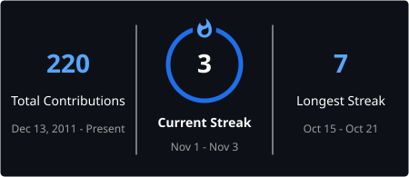
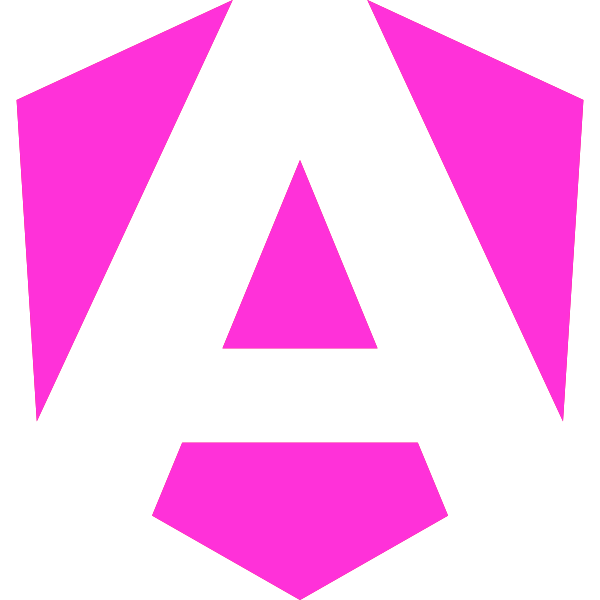
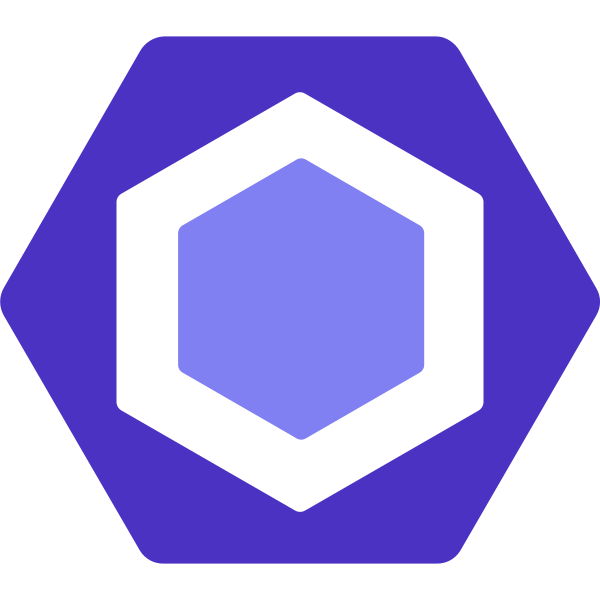
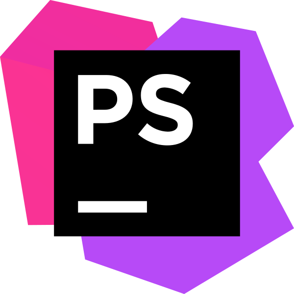

<h1 align="left">こんにちは〜 Tora desu~ 🐯</h1>

I make <strike>poorly written</strike> websites, chatbots, and mods for games. Someday I want to create my own games.

 

<!-- -------------------------------- Stats / Streak -------------------------------- -->

<table align="center">
    <tr>
        <th align="center">GITHUB STATS</th>
    </tr>
    <tr>
        <td width="480" align="center">
            
             
            
        </td>
    </tr>
</table>

 

<!-- -------------------------------- Skills -------------------------------- -->

<table align="center">
    <tr>
        <th align="center">LANGUAGES</th>
    </tr>
    <tr>
        <td width="480" align="center">
            
             
            
            
            
            
            
            
            
            
            
            
            
            
            
            
            
        </td>
    </tr>
</table>

<table align="center">
    <tr>
        <th align="center">FRAMEWORKS</th>
    </tr>
    <tr>
        <td width="480" align="center">
            
            
            
            
            
            
            
            
            
            
            
            
            
            
        </td>
    </tr>
</table>

<table align="center">
    <tr>
        <th align="center">TOOLS</th>
    </tr>
    <tr>
        <td width="480" align="center">
            
            
            
            
            
            
            
            
            
            
            
            
            
            
            
            
            
            
            
            
            
            
            
            
            
            
            
        </td>
    </tr>
</table>

<table align="center">
    <tr>
        <th align="center">AGENTS</th>
    </tr>
    <tr>
        <td width="480" align="center">
            
            
            
            
            
            
            
        </td>
    </tr>
</table>

<table align="center">
    <tr>
        <th align="center">ENVIRONMENT</th>
    </tr>
    <tr>
        <td width="480" align="center">
            
            <!--img src="./profile/icons/gitlab.svg" alt="GitLab" height="32" /-->
            
            
            
            
        </td>
    </tr>
</table>

 

<!-- -------------------------------- Socials -------------------------------- -->

<table align="center">
    <tr>
        <th align="center">SOCIAL LINKS</th>
    </tr>
    <tr>
        <td width="480" align="center">
            
            <!--a href=""></a-->
            <!--a href=""></a-->
            
            
            <!--a href=""></a-->
            <!--a href=""></a-->
            <!--a href=""></a-->
             
            
            <!--a href="https://www.buymeacoffee.com/toranaado" align="center"></a-->
        </td>
    </tr>
</table>

<!-- Yes, I am aware this file is HTML and not Markdown, but it looks prettier~ -->
